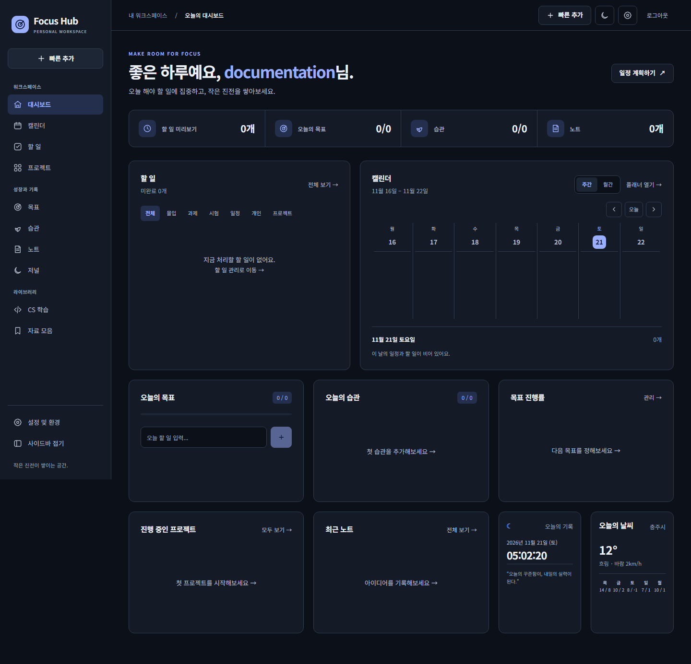
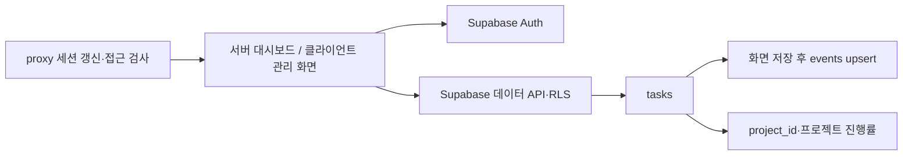

# Focus Hub

할 일·캘린더·프로젝트·목표·습관·노트를 하나의 개인 작업 공간으로 연결한 생산성 웹앱입니다.

## 01. Project Overview

여러 화면에 흩어진 작업과 기록을 대시보드에서 확인하고, 할 일의 날짜·프로젝트 연결을 일정과 진행률에 반영합니다. Supabase 계정별 저장과 데스크톱·모바일 탐색을 함께 구성했습니다.

## 02. Demo & Screenshots

[GitHub](https://github.com/peeta0126/Focus-Hub). 현재 저장소 설정만으로 운영 배포 URL을 확정하지 않았습니다.



2026-11-21 로컬 앱의 빈 작업 공간을 캡처했습니다. 운영 사용자 데이터가 아니며 개발 도구 오버레이만 숨겼습니다. `public/assets/`의 일러스트와 구분합니다.

사용 흐름은 회원가입 → 이메일 인증 → 대시보드 → 할 일·프로젝트 등록 → 캘린더와 진행률 확인 → 습관·노트 기록입니다.

## 03. Key Features

- **할 일·캘린더 연결:** 제목·우선순위·상태·마감·프로젝트를 저장하고 `events.source_task_id`를 기준으로 일정을 upsert합니다. 연결 일정은 캘린더에서 직접 편집하지 않고 할 일 화면으로 안내합니다.
- **프로젝트:** 목록·상태·검색과 상세의 연결 할 일을 관리합니다. 완료한 할 일 비율로 진행률을 계산합니다. 프로젝트 삭제 시 할 일은 삭제하지 않고 연결을 해제하는 FK를 정의합니다.
- **목표·습관:** 장기 목표의 진행률, 날짜별 오늘 목표, 습관 목록과 월간 완료 기록을 관리합니다.
- **노트·기록:** 노트 검색·태그·본문 편집·저장, 저널 저장, CS 학습 기록·자료 관리를 제공합니다. 저널 화면은 저장 폼이며 과거 기록 전체 조회 기능까지 구현했다고 주장하지 않습니다.
- **대시보드:** 주간·월간 일정과 할 일, 목표·습관·프로젝트·최근 노트, 시계·날씨를 모읍니다. 날씨는 Open-Meteo 지오코딩/예보 API를 사용합니다.
- **계정:** Supabase 이메일 가입·확인·재전송·로그인·로그아웃·비밀번호 재설정과 보호 경로를 제공합니다.
- **반응형 UI·PWA:** 사이드바, 모바일 하단 탭, 빠른 추가와 테마 전환을 제공합니다. 서비스 워커는 공개 정적 자원만 캐시합니다.

## 04. Tech Stack

`package-lock.json` 기준: Next.js **16.3.8**, React **19.3.0**, TypeScript **6.0.3**, Tailwind CSS **4.3.3**, Supabase JS **2.117.2** / SSR **0.12.7**, React Hook Form **7.89.0**, Zod **4.6.5**.

App Router 서버 화면과 클라이언트 컴포넌트를 나누고 로컬 React 상태·폼 상태·Router 갱신을 사용합니다. 인증·PostgreSQL·브라우저 데이터 API는 Supabase가 담당합니다. 브라우저 검사는 Playwright의 Chromium 데스크톱/모바일 에뮬레이션입니다. 별도 자체 백엔드 REST 서버는 없습니다.

## 05. Architecture



주요 모델은 `tasks`, `projects`, `events`, `goals`, `daily_goals`, `habits`, `habit_records`, `notes`, `journal_entries`, `cs_study_logs`, `resources`, `settings`입니다. `user_id` 필터와 RLS 정의로 계정 범위를 제한합니다. 할 일과 일정 저장은 클라이언트의 별도 요청이며 DB 트랜잭션이나 실시간 양방향 동기화가 아닙니다. 일정 저장 실패는 부분 성공 안내와 재시도로 처리합니다.

## 06. Technical Challenges & Solutions

- **계정 전환 후 이전 화면 잔존 위험 → React·Router 메모리 상태 → 로그인/로그아웃의 전체 페이지 이동과 세션 쿠키 전달 → [인증 브라우저 검사](tests/auth.spec.ts)의 재로그인·계정별 노트 구분.** 실제 PostgreSQL RLS 검증과는 별개입니다.
- **구버전 CSS와 새 화면 혼합 → 서비스 워커의 Next 번들 Cache First → `/_next/` 제외와 앱 소유 캐시만 정리 → [캐시 회귀 검사](tests/cache.spec.ts).** 해당 검사의 존재와 이번 실행 여부는 구분합니다.
- **할 일 저장과 일정 갱신 불일치 → 두 API 요청 중 후속 요청 실패 → 부분 성공 메시지·동일 source_task_id 재저장 → [구현](src/components/tasks/TaskManager.tsx)과 [연결 흐름 검사](tests/redesign.spec.ts).**

## 07. My Contributions

위 항목은 저장소 전체 기능입니다. 개인/팀 구분, 직접 담당 범위, AI 도구 사용 범위와 당시 기술 선택의 동기는 코드·Git 작성자만으로 확정하지 않습니다. 채용 자료에 넣을 개인 기여는 본인 확인이 필요합니다.

## 08. Getting Started

Node.js 22 이상과 npm을 권장합니다.

```sh
npm ci
npm run dev
```

[.env.example](.env.example)을 `.env.local`로 복사하고 `NEXT_PUBLIC_SUPABASE_URL`, `NEXT_PUBLIC_SUPABASE_ANON_KEY`를 설정합니다. anon key는 RLS와 함께 사용하는 공개 클라이언트 키이며 service role 비밀키로 대체하지 않습니다.

새 Supabase 프로젝트의 SQL Editor에서 [schema.sql](supabase/schema.sql)을 **한 번** 적용합니다. 기존 DB에 초기 스키마를 재실행하지 말고 누락된 [마이그레이션](supabase/migrations)을 날짜 순으로 검토·적용합니다. 일일 목표, Task–Event와 Task–Project 연결을 포함하며 적용 전 백업과 현재 스키마 확인이 필요합니다. 앱 시작 시 DB를 자동 초기화하지 않습니다.

[인증 설정과 운영 검증](AUTHENTICATION.md)에 따라 이메일·redirect·메일 템플릿을 설정합니다. 환경변수가 없으면 일부 빈 UI는 렌더링되지만 로그인·영구 저장은 사용할 수 없습니다.

```sh
npm run lint
npm run build
npm start
npx playwright install chromium
npm run test:auth
```

`test:auth`는 이름과 달리 `tests/` 전체를 실행합니다. 인증만 검사하려면 `npm run test:auth -- tests/auth.spec.ts`를 사용합니다. 로컬 fixture 54329, 개발 서버 3197과 `.next-test`를 사용하며 실제 Supabase 계정·DB에 쓰지 않습니다. 빌드와 브라우저 테스트는 순서대로 실행합니다.

## 09. Project Structure

```text
src/app/          대시보드·관리 화면·인증 확인 Route Handler
src/components/   인증·대시보드·관리 UI·공통 레이아웃
src/lib/          타입·날짜·인증·Supabase 클라이언트
src/proxy.ts      세션 갱신·보호 경로
supabase/         초기 스키마·추가 마이그레이션
tests/            인증·레이아웃·캐시·접근성·CRUD fixture 검사
public/           일러스트·아이콘·서비스 워커
```

## 10. Current Status & Limitations

문서 기준일은 2026-11-21입니다. `npm run test:auth -- tests/auth.spec.ts`에서 6개 시나리오 각각의 성공 표시를 확인했으나, 서버 종료 대기가 계속되어 수동 중단했습니다(종료 코드 1). 전체 명령이 정상 통과했다고 표시하지 않습니다. 외부 통신 제한 경고와 캡처 과정의 hydration 경고도 관찰했습니다. 나머지 CRUD·캐시·접근성 검사와 빌드는 이번에 재실행하지 않았습니다.

운영 SMTP 수신·실제 두 계정의 PostgreSQL RLS·실기기 브라우저·배포 상태는 별도 검증이 필요합니다. PWA는 오프라인 CRUD·백그라운드 동기화를 제공하지 않습니다. 외부 날씨 서비스와 네트워크 장애 시 일부 정보는 실패 안내로 표시됩니다.

기존 로컬 `docs/`는 Git 제외 대상이므로 GitHub 안내 링크로 사용하지 않습니다. 기존 로컬 설계·성능 기록은 삭제하거나 최신 측정값으로 재해석하지 않고 보존합니다.
